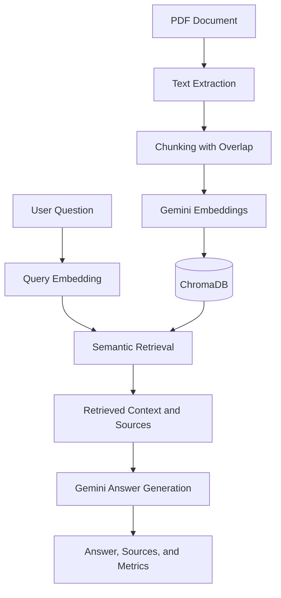

# Document Q&A API — Retrieval-Augmented Generation (RAG)

A Python-based **Retrieval-Augmented Generation (RAG)** application that answers questions about PDF documents using semantic search, Google Gemini, and ChromaDB. The application exposes the pipeline through a REST API built with FastAPI.

The project includes PDF ingestion, vector retrieval, source metadata, retrieval evaluation, performance measurements, and automated tests.

## Key Features

- **PDF ingestion:** Extract text from PDF pages, split it into overlapping chunks, and prepare it for retrieval.
- **Semantic search:** Generate embeddings with Google's Gemini embedding model and retrieve relevant passages from ChromaDB.
- **Context-grounded answers:** Generate answers using retrieved document context, with instructions to avoid unsupported claims.
- **REST API:** Submit questions through FastAPI and receive answers, source metadata, latency, and token usage.
- **Retrieval evaluation:** Benchmark retrieval using Hit Rate, Precision, Recall, and Mean Reciprocal Rank (MRR).
- **Performance tracking:** Measure embedding, retrieval, generation, and total request time.
- **Error handling:** Handle known RAG errors and unexpected API failures, with bounded retries for selected transient Gemini API errors.
- **Automated tests:** Use pytest to test application behavior.

## Architecture



## Technology Stack

| Technology | Purpose |
|---|---|
| Python | Application logic |
| Google Gen AI SDK | Embeddings and answer generation |
| Gemini | Language model and embedding model |
| ChromaDB | Persistent vector storage and similarity search |
| FastAPI | REST API |
| Pydantic | Request and response validation |
| Uvicorn | API server |
| pypdf | PDF text extraction |
| pytest | Automated testing |

## Project Structure

```text
RAG_Project/
├── main.py                 # FastAPI endpoints
├── rag_engine.py           # Retrieval and answer generation
├── ingest.py               # PDF ingestion and vector storage
├── config.py               # Environment-based configuration
├── evaluation.py            # Retrieval evaluation and benchmarks
├── evaluation_dataset.py   # Evaluation questions and expected facts
├── test_main.py             # Automated tests
├── chat.py                  # Optional command-line RAG demo
├── document.pdf             # Sample PDF document
├── requirements.txt         # Python dependencies
├── .env.example             # Environment variable template
├── .gitignore               # Excludes secrets and generated files
└── README.md
```

## Getting Started

### Prerequisites

- Python 3.11 or newer recommended
- A Google Gemini API key
- Git
- Internet access for Gemini API requests

The project has previously been tested with Python 3.14.

### 1. Clone the repository

```powershell
git clone https://github.com/shubhamjassal/rag-api-gemini-chromadb.git
cd rag-api-gemini-chromadb
```

### 2. Create and activate a virtual environment

On Windows PowerShell:

```powershell
py -m venv .venv
.\.venv\Scripts\Activate.ps1
```

### 3. Install dependencies

```powershell
python -m pip install -r requirements.txt
```

### 4. Configure your Gemini API key

Create a local `.env` file from the template:

```powershell
Copy-Item .env.example .env
```

Open `.env` and replace the placeholder with your own API key:

```text
GEMINI_API_KEY=your_gemini_api_key_here
```

Keep your actual key private. Never commit `.env` or expose API keys in source code.

### 5. Ingest the PDF

The included sample PDF is `document.pdf`. Run:

```powershell
python ingest.py
```

The ingestion script extracts text, creates chunks and embeddings, and stores the resulting document data in ChromaDB. Check the script output to confirm ingestion completed successfully.

Run ingestion before asking questions against a fresh local database.

### 6. Start the API

```powershell
python -m uvicorn main:app --reload
```

The API runs locally at `http://127.0.0.1:8000`.

| Endpoint | Method | Purpose |
|---|---|---|
| `/` | GET | Check that the API is running |
| `/health` | GET | Check service health |
| `/ask` | POST | Ask a question about the document |
| `/docs` | GET | Explore the interactive API documentation |

## API Usage

### Ask a question

Send a `POST` request to `/ask` with a JSON body:

```json
{
  "question": "What is Retrieval-Augmented Generation?"
}
```

You can try this interactively at [http://127.0.0.1:8000/docs](http://127.0.0.1:8000/docs) after starting the server.

### Response format

The response includes an answer, source references, latency, pipeline timings, and token usage.

```json
{
  "answer": "An answer based on the retrieved document context.",
  "sources": [
    {
      "source": "document.pdf",
      "page": 3,
      "chunk_id": 2
    }
  ],
  "latency_seconds": 2.45,
  "timings": {
    "embedding_seconds": 0.25,
    "retrieval_seconds": 0.05,
    "generation_seconds": 2.1,
    "total_seconds": 2.4
  },
  "usage": {
    "input_tokens": 500,
    "output_tokens": 40,
    "total_tokens": 540
  }
}
```

*The values above are illustrative; actual answers, sources, timings, and token counts depend on the question and API response.*

## Retrieval Evaluation

The project includes a five-question evaluation dataset and a benchmark comparing different values of `TOP_K`—the number of chunks retrieved for each question.

### Previously measured results

These results are preliminary and based on a five-question evaluation dataset. They measure retrieval behavior only on the current sample and should not be interpreted as evidence of production-level retrieval accuracy or answer quality. Results may differ with a larger, more diverse dataset.

| TOP_K | Hit Rate | Precision | Recall | MRR |
|---:|---:|---:|---:|---:|
| 1 | 0.400 | 0.400 | 0.400 | 0.400 |
| 3 | 1.000 | 0.500 | 1.000 | 0.667 |
| 5 | 1.000 | 0.417 | 1.000 | 0.667 |
| 10 | 1.000 | 0.213 | 1.000 | 0.667 |

### What the results suggest

- `TOP_K=1` missed relevant material for some questions in this dataset.
- `TOP_K=3` achieved full Hit Rate and Recall in the measured benchmark while returning fewer chunks than `TOP_K=5` or `TOP_K=10`.
- Increasing `TOP_K` did not improve Hit Rate, Recall, or MRR beyond the measured `TOP_K=3` results.
- Precision decreased at larger values of `TOP_K`, indicating that retrieving more chunks did not necessarily mean retrieving more relevant chunks.

For this dataset, `TOP_K=3` is a reasonable starting point. A larger and more diverse evaluation dataset is needed before drawing broader conclusions.

## Running Tests

Run the automated test suite:

```powershell
python -m pytest -q
```

The latest verified test run reported **7 passed, 2 warnings** in the review environment. Both warnings concern deprecated APIs in dependencies (ChromaDB and the Google GenAI SDK); neither caused a test failure. Results may vary with dependency versions and Python environments.

## Limitations

- The evaluation dataset is small and does not establish general retrieval or answer quality.
- Answer generation and embeddings require Gemini API access and are subject to provider quotas and rate limits.
- The vector database is stored locally and must be populated through ingestion.
- Retrieved context does not guarantee that every generated answer is correct or fully supported.
- The application has not been presented here as a production deployment; production use would require additional security, monitoring, operational controls, and broader evaluation.

## Future Improvements

- Expand the evaluation dataset with more questions and ground-truth annotations.
- Add answer-quality and source-grounding evaluation.
- Compare chunking strategies, embedding models, hybrid retrieval, and reranking.
- Add regression tests for retrieval failures and unsupported questions.
- Add authentication, deployment configuration, and operational monitoring.
- Track latency, API usage, and evaluation results across repeatable experiments.

## Security

- Store credentials in a local `.env` file.
- Keep `.env`, local databases, caches, and other generated files out of version control.
- Never commit API keys or other secrets.
- Use appropriate authentication and access controls before exposing the API to untrusted users.

## License

No license is currently specified. Check the repository's licensing requirements before reusing or redistributing this project.